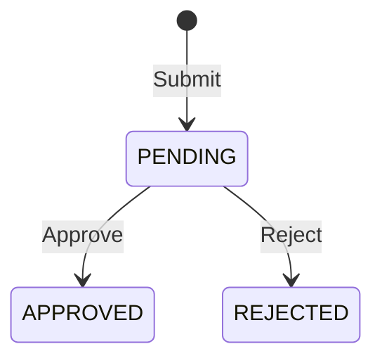

# 📖 API Guide

The examples use the default local API address, `http://localhost:8080`.
For request payloads beyond these examples, see the
[Postman collection](https://documenter.getpostman.com/view/23207346/2sA3duEsLN).
See [Runtime](runtime.md) for middleware, retries, and monitoring.

## Sign in

After applying migrations to a local database, sign in with the demo
administrator (`admin` / `password`):

```bash
curl -fsS http://localhost:8080/login \
  -H 'Content-Type: application/json' \
  -d '{"username":"admin","password":"password"}'
```

The response includes `access_token` and `refresh_token`. Use the access
token as `Authorization: Bearer <access-token>` on protected requests.
Send the refresh token as `{"refresh_token":"..."}` to `POST /auth/refresh`
to obtain a new token pair. `POST /auth/logout` and `POST /auth/logout-all`
require an access token.

## Routes at a glance

| Resource | Routes |
| --- | --- |
| Users | `GET /users/`, `POST /users/`, `GET /users/{id}`, `PUT /users/{id}` |
| Approvals | `GET /approvals/`, `POST /approvals/`, `GET /approvals/{id}`, `PUT /approvals/{id}/action` |
| Health and diagnostics | `GET /health`, `/metrics`, `/debug/pprof/`; see [monitoring](runtime.md#health-metrics-and-profiles) for the required header. |

User and approval routes require an access token and the appropriate
permissions.

## Approval workflow



- Submit with `POST /approvals/` and the `create_approval` permission.
- Approve or reject with `PUT /approvals/{id}/action` and both `read_approval`
  and `action_approval`. Send `{"action":"APPROVED"}` or `{"action":"REJECTED"}`.

Only pending approvals can be acted on; the API does not reopen an approval
once it is approved or rejected.

## Paginate the lists

[Seed demo data](development.md#demo-data) first if you want enough rows to
try multiple pages. Set `ACCESS_TOKEN` to the access token returned at login.

**Users use page numbers.** Pass `page` and `per_page` (defaults: 1 and 10,
page size capped at 100). Optional filters are `name` and `role`. The
response contains `data` plus `meta.total`, `meta.per_page`,
`meta.current_page`, and `meta.last_page`.

```bash
curl -fsS -H "Authorization: Bearer ${ACCESS_TOKEN}" \
  'http://localhost:8080/users/?page=2&per_page=10'
```

**Approvals use a cursor.** Start without a `cursor`. Pass `limit` to set the
page size (default 10, capped at 100) and optionally filter by `status`
(`PENDING`, `APPROVED`, or `REJECTED`).

```bash
curl -fsS -H "Authorization: Bearer ${ACCESS_TOKEN}" \
  'http://localhost:8080/approvals/?status=PENDING&limit=10'
```

When `meta.has_more` is true, send the returned `meta.next_cursor` as the
`cursor` query parameter on the next request, keeping the same filter.
Treat the cursor as an opaque value rather than constructing it yourself.
