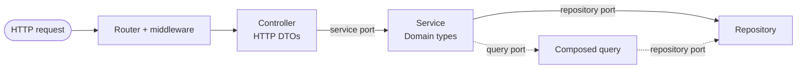
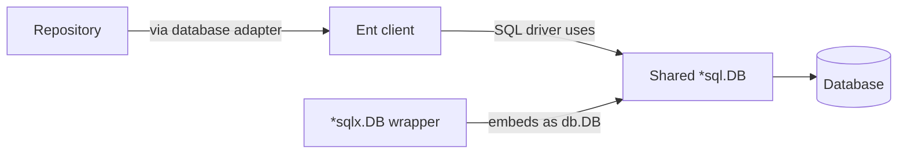

# 🏗️ Architecture

Go HRIS has two long-running processes and two database utilities:

| Entry point | Responsibility |
| --- | --- |
| [`cmd/server`](../cmd/server) | Serves the Chi HTTP API and monitoring endpoints. |
| [`cmd/worker`](../cmd/worker) | Runs the scheduler and the consumer registry independently of the API. |
| [`cmd/migrate`](../cmd/migrate) | Applies or rolls back the SQL migrations. |
| [`cmd/seed`](../cmd/seed) | Populates a disposable development database for demos. |

## Request and data flow

### Request path



The arrows show calls, not imports. [`internal/ports`](../internal/ports)
defines the interfaces on those calls. [`internal/domains`](../internal/domains)
contains the shared domain types; repositories map between those types and
Ent records. Dashed lines show the optional composed-query path.

### Database wiring



The [database adapter](../internal/infra/database/database.go) creates the
pool with `sqlx.Open` and hands the underlying `db.DB` to `entsql.OpenDB`.
The two branches share a pool; Ent queries do not go through the sqlx wrapper.

## 📂 Project Layout

```text
.
├── .github/            # Repository automation and instructions
├── build/
│   └── package/        # Container build assets
├── cmd/                # Entry points
│   ├── migrate/
│   ├── seed/
│   ├── server/
│   └── worker/
├── configs/            # Default configuration
├── deployments/        # Deployment definitions
├── docs/               # Project documentation
├── ent/
│   ├── entgen/         # Generated data-access code
│   └── schema/         # Data model definitions
├── internal/
│   ├── constants/      # Shared constants
│   ├── domains/        # Domain types
│   ├── dtos/           # Request and response types
│   ├── errors/         # Application errors
│   ├── http/           # Routes, middleware, and controllers
│   ├── infra/          # Infrastructure adapters
│   ├── mocks/          # Test doubles
│   ├── pkg/            # Shared utilities
│   ├── ports/          # Interfaces between layers
│   ├── queries/        # Composed reads
│   ├── repositories/   # Data access
│   ├── services/       # Business rules and permissions
│   └── worker/         # Scheduler, jobs, and consumer handlers
├── migrations/         # Database migrations
└── scripts/            # Development scripts
```

`build/ci/` is a possible addition if the project needs reusable CI assets;
it is not part of the current layout. GitHub Actions workflow definitions,
if added, belong in `.github/workflows/`.

## Dependency injection and background work

[Server Wire providers](../cmd/server/wire.go) compose the router, HTTP
middleware, services, PostgreSQL, and Redis; [worker Wire providers](../cmd/worker/wire.go)
reuse database, cache, and auth services without serving HTTP. Both binaries
also use the common logger and alerter. See [code generation](development.md#code-generation)
for how to update the injectors.

The worker registers a job to delete expired refresh tokens at 02:00 in the
process's local time zone. The consumer currently registers handlers and waits
for cancellation; it does not consume messages from an external broker.
For shutdown behavior, see [Runtime](runtime.md#process-lifecycle).
